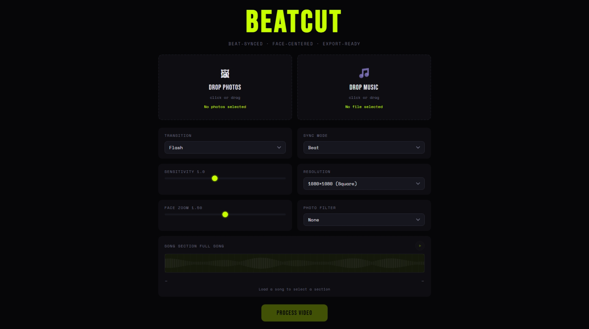
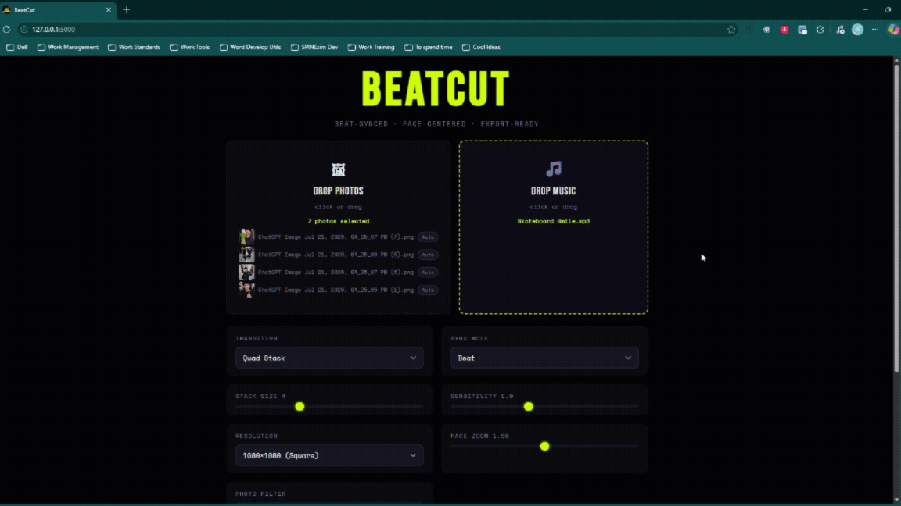
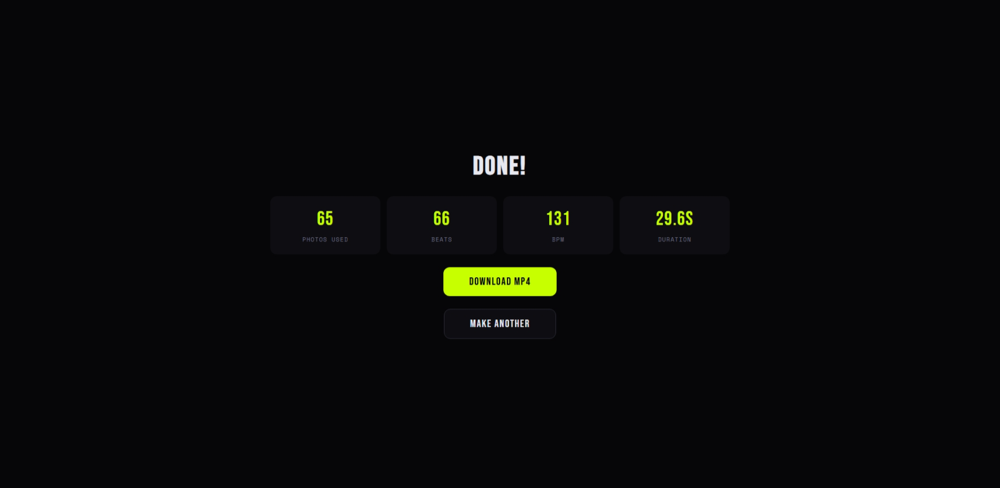

# BeatCut

Beat-synced, face-centered slideshow video generator.





## Prerequisites

- Python 3.12 (developed on 3.12.10; `moviepy` is pinned to 1.0.3, newer Pythons are untested)
- ffmpeg installed and on your `PATH` (`ffmpeg -version` should work in a new terminal)

### Install ffmpeg

**Windows:**
```
winget install ffmpeg
# or
choco install ffmpeg
```

**macOS:**
```
brew install ffmpeg
```

**Linux (Debian/Ubuntu):**
```
sudo apt update && sudo apt install ffmpeg
```

## Setup

```bash
git clone https://github.com/Ledsav/beatcut.git
cd beatcut
python -m venv .venv
source .venv/Scripts/activate   # Windows (Git Bash); PowerShell: .venv\Scripts\Activate.ps1
# source .venv/bin/activate     # macOS / Linux
pip install -r requirements-dev.txt   # requirements.txt + pytest
python app.py
```

Open http://localhost:5000 in your browser.

In VS Code, **Terminal → Run Task… → Setup (fresh clone)** creates `.venv`, installs `requirements-dev.txt`, checks that ffmpeg is on `PATH` (it stops with a message if not) and runs the tests. **Dev** starts the app.

## Testing

```bash
python -m pytest -v   # tests/test_processor.py, with the venv active
```

The tests build their own short audio and images, so no sample files are needed.

## Gallery

| Upload | Result |
|---|---|
|  |  |

See it in motion: [`docs/gallery/usecase.gif`](docs/gallery/usecase.gif) (full walkthrough) and a rendered example clip at [`docs/gallery/beatcut_output.mp4`](docs/gallery/beatcut_output.mp4).

## Settings

| Setting | Description |
|---|---|
| **Transition** | Flash: white flash between clips. Hard Cut: instant switch. Fade: cross-dissolve. Zoom In: scale 1.3→1.0 into next clip. Polaroid Stack: photos land on a sliding pile of Polaroids. Quad Stack: clips tile into a grid that grows/shrinks with the beat. |
| **Sync Mode** | What the cuts lock to: Beat, Melody, Drums, or overall Energy. |
| **Beat Sensitivity** | 0.3 = every beat, 2.0 = only major beats. Controls `step = max(1, round(1/sensitivity))` subsampling. |
| **Resolution** | Output dimensions. 1080×1080 for square social, 1920×1080 for widescreen, 1080×1920 for vertical/Reels, 720×720 for a smaller export. |
| **Face Zoom** | 1.0 = tight face crop, 2.0 = zoomed-out context. Divides the crop window by this factor. |
| **Photo Filter** | None, Vignette, Grain, Vintage, or Faded — applied to every frame. |
| **Song Section** | Trim the waveform to sync only part of the track instead of the full song. |
| **Polaroid Landing** *(Polaroid Stack only)* | Drop, Flash, Fade, or Cut — how each photo lands on the pile. |
| **Stack Size** *(Quad Stack only)* | Number of clips tiled per grid (2–8). |

## Troubleshooting

| Error | Fix |
|---|---|
| `ffmpeg not found` | Install ffmpeg and ensure it's in your PATH. Run `ffmpeg -version` to confirm. |
| `No faces detected` | App falls back to image center. Check that photos contain forward-facing or profile faces. |
| `Audio decode error` | Ensure the audio file is a valid MP3, WAV, FLAC, or OGG. Re-export from your DAW if corrupt. |
| `module 'cv2' has no attribute 'CascadeClassifier'` | OpenCV 5 is installed. Run `pip install -r requirements.txt` (it pins `opencv-python<5`). |
| `moviepy version mismatch` | Run `pip install moviepy==1.0.3` — newer versions break the API used here. |
| `SSE stream hangs` | Ensure Flask is running with `threaded=True` (it is by default in `app.run()`). |
